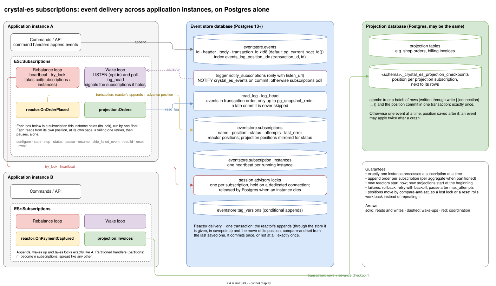

# crystal-es

An event sourcing library for Crystal

[](https://github.com/tristanholl/crystal-es/actions/workflows/ci.yml)

## Installation

1. Add the dependency to your `shard.yml`:

   ```yaml
   dependencies:
     crystal-es:
       github: tristanholl/crystal-es
   ```

2. Run `shards install`

## Overview

`crystal-es` is an event sourcing foundation for Crystal applications. It is optimized for PostgreSQL as event store, queue, and projection database, and was originally extracted from an open-source core-banking project.

The library provides:
- **Aggregates** — reconstruct domain state by replaying events
- **Commands** — pure data records expressing an intent to change state
- **Command Handlers** — enforce business logic and emit events
- **Reactors** — consume events off the bus and trigger the next command
- **Events** — immutable facts with a type-safe DSL
- **Projections** — read models built from event streams, with a schema DSL and schema drift detection
- **Event Bus** — fan-out published events to reactors and projections
- **Subscriptions** — deliver events to reactors and projections exactly once and in order, across any number of application instances, on Postgres alone (see [Subscriptions](#subscriptions))
- **Dynamic consistency boundaries** — tag events, read them by type and tag, and append on the condition that none of the tags a decision depended on moved (see [Tags](#tags), [Querying by tag](#querying-by-tag), [Tag versions and conditional appends](#tag-versions-and-conditional-appends) and [Decision projections](#decision-projections))
- **Adapters** — PostgreSQL and in-memory implementations for event stores and queues

A complete working example lives in [`./examples/financial-transaction`](./examples/financial-transaction). [`./examples/course-subscription`](./examples/course-subscription) shows dynamic consistency boundaries: course capacity and a per-student limit enforced together, unique hashed emails, and erasure.

See the [changelog](./CHANGELOG.md) for upgrade notes between versions.

---

## Components

### Event

`ES::Event` is the base class for all domain events. Each event carries a **Header** (metadata) and a **Body** (event-specific payload).

```crystal
class OrderPlaced < ES::Event
  aggregate_type "order"
  event_handle "order_placed"

  class Body
    include JSON::Serializable
    getter order_id : UUID
    getter amount : Int64

    def initialize(@order_id, @amount); end
  end
end
```

#### Event DSL

The `define_event` macro removes the boilerplate. It generates the full event class, the `Body` struct with JSON serialization, and registers the handle automatically.

```crystal
define_event("order", "order_placed") do
  attribute :order_id, UUID
  attribute :amount, Int64
  attribute :currency, String, "EUR"   # optional default
end
```

`attribute(name, type, default?)` — declare a typed field on the event body. A default value makes the field optional at construction time. Declare attributes without a default before those with one; the compiler rejects the other order.

#### Tags

`tag(name, type, hashed: false)` — declare a tag: a value carried in the event header. Tags are the groundwork for dynamic consistency boundaries: instead of one aggregate's stream, a consistency boundary becomes "every event carrying these tags".

Tags and attributes are independent of each other. A tag may share its name with an attribute, and may hold the same value or a different one. It can also name something the body doesn't carry at all, such as a second aggregate whose consistency the event takes part in, without coupling it into the payload.

```crystal
define_event("course", "student_subscribed") do
  attribute :course_id, UUID
  attribute :student_id, UUID
  tag :course_id, UUID                 # stored as "course_id:<uuid>"
  tag :student_id, UUID
end

define_event("student", "student_registered") do
  attribute :student_id, UUID
  tag :student_id, UUID
  tag :email, String, hashed: true     # stored as "email:<hmac>", the value nowhere else
end

StudentSubscribed.new(
  actor_id: actor, command_handler: "Subscribe",
  course_id: course_id, student_id: student_id,
  tags: {course_id: course_id, student_id: student_id}
)
```

- The constructor takes the tag values as one `tags:` named tuple, whose keys and types the compiler checks against the declarations. Every declared tag must be present. One declared with a nilable type, such as `UUID?`, may be `nil`, and then the event carries no such tag. An event without tags has no `tags:` argument. Pass `tags:` by name: it sits after the attributes without a default and before those with one.
- Values are stored in their `to_s` form, so a query matches when it passes a value with the same `to_s`. In practice, use the same type.
- The event store writes tags to the event header (`header.tags`) on append, in their stored form, together with their versions (`header.tag_versions`, see [Tag versions](#tag-versions-and-conditional-appends)). `event.tags` holds the plaintext values the event was built with. An event read back only has the stored form, and a hashed tag only its digest. Put a value in an attribute too if code needs it after reading the event back. Appending a read-back event again keeps its stored tags exactly as they are, without hashing them again. A store with a different application key, or with no tag hasher, won't find its hashed tags. Stored tags are checked before they are kept, because a header can also come from elsewhere, such as a queue message. Every key must be declared by the event class, and a hashed key must hold a digest. Otherwise the append raises `ES::Exception::InvalidState`.
- A tag without a type, a duplicate tag, an unknown option, a non-boolean `hashed:`, or an attribute named `tags` next to declared tags is a compile error.
- If the same tag key is `hashed: true` in one event and `hashed: false` in another, compilation emits a warning. Keeping a key consistent across events is the application's job: a query hashes a tag value according to how the key is declared, so the inconsistent events would not be found.

**Hashed tags.** `hashed: true` stores an HMAC-SHA256 of the value (truncated to 128 bits), keyed by a key derived from the application encryption key. It is off by default and has to be switched on:

```crystal
ES::Config.tag_hasher = ES::TagHasher.new(application_key) # ES::ApplicationEncryptionKeyManager
```

Unhashed tags need no configuration. Appending an event with a hashed tag while no hasher is configured raises `ES::Exception::InvalidState`, rather than storing the value in the clear. Event stores read `ES::Config.tag_hasher` when they are constructed, so configure it before building them, or pass `tag_hasher:` to the store directly.

What hashing does and does not protect:

- A database dump alone does not reveal hashed values. A plain hash would: email addresses and names fall to a dictionary attack within seconds, which is why the digest is keyed.
- The same value always yields the same digest, which is what lets a query find it. Whoever holds the application key can therefore still test whether a known value appears in the store. A hashed tag is pseudonymous data, not anonymous data.
- Tags are not crypto-shredded. Destroying an event's encryption key erases its body, but not its tags. A tag holding personal data outlives the erasure. An unhashed tag on an `encrypted: true` event stores its value in the clear in the header, even if the body holds the same value encrypted.
- Hashing only keeps a value out of the header. If the body carries the same value as an attribute of an event without `encrypted: true`, the value is still stored in the clear there. A hashed tag whose value lives in no attribute (and not in the free-text `comment`) is stored only as its digest.
- The derived key cannot be rotated: every stored digest depends on it, the same way every wrapped data key depends on the application key.

Prefer tagging by a surrogate id (a UUID) over personal data. Use `hashed: true` where that isn't possible.

---

### Aggregate

`ES::Aggregate` reconstructs domain state from its event history. Each aggregate defines a `State` struct and a set of `apply` overloads — one per event type.

```crystal
class Order < ES::Aggregate
  struct State
    property placed : Bool = false
    property amount : Int64 = 0_i64
  end

  def apply(event : OrderPlaced)
    @state.placed = true
    @state.amount = event.body.amount
  end
end
```

Call `Order.hydrate(aggregate_id, event_store)` to reconstruct an aggregate from persisted events.

---

### Command

`ES::Command` is a pure data record expressing an intent to change state. Following strict event sourcing, it carries only the target aggregate and its payload — it has no behavior.

```crystal
struct PlaceOrder < ES::Command
  getter amount : Int64

  def initialize(@aggregate_id : UUID, @amount : Int64)
  end
end
```

---

### Command Handler

`ES::CommandHandler(C)` encapsulates a single business operation. It is generic over the command type `C` it processes, so `handle(command : C)` is checked by the compiler. It hydrates the relevant aggregate, enforces state invariants, and appends new events.

A handler is a plain object — construct it and call `handle` directly. From an API endpoint that call is synchronous, so an invariant violation raises right where you can turn it into a response:

```crystal
class PlaceOrderHandler < ES::CommandHandler(PlaceOrder)
  def handle(command : PlaceOrder)
    order = Order.new(command.aggregate_id, event_store: @event_store)
    order.hydrate
    raise ES::Exception::InvalidState.new("already placed") if order.state.placed

    @event_store.append(OrderPlaced.new(
      aggregate_id: command.aggregate_id,
      body: OrderPlaced::Body.new(amount: command.amount)
    ))
  end
end

# In an API controller — invariant failures surface synchronously
PlaceOrderHandler.new.handle(PlaceOrder.new(aggregate_id: id, amount: 500_i64))
```

---

### Reactor

`ES::Reactor` consumes events from the `EventBus` and reacts to them — typically by constructing a command and calling its handler directly. It is the one bridge from an event back to a command; each step of a workflow is a named reactor. Declare the events it handles by defining a typed `call` for each, the same way a projection declares its events with typed `apply` overloads:

```crystal
class OnOrderPlaced < ES::Reactor
  def call(event : OrderPlaced)
    ReserveStockHandler.new(event_store: @event_store).handle(
      ReserveStock.new(aggregate_id: event.header.aggregate_id)
    )
  end
end
```

A reactor may declare several events by defining one `call` per event. Routing itself stays in the `EventBus` wiring, so the full fan-out of an event across workflows is readable in a single place; `subscribe` checks this declaration and refuses a subscription the reactor cannot serve.

Reaching a reactor with an event it declares no `call` for raises `ES::Exception::InvalidState`. A projection may legitimately ignore an event, but a reactor doing so means a workflow step was silently dropped.

---

### Projection

`ES::Projection` maintains a read model by consuming events in order. It can be replayed from scratch at any time.

#### Projection DSL

`define_projection` generates the full projection class — table creation, column definitions, index setup, and event handlers — from a concise block.

```crystal
class Postings < ES::Projection
  include ES::ProjectionDSL

  define_projection "ledger.postings" do
    column :id,         UUID, primary_key: true
    column :account_id, UUID
    column :amount,     Int64
    column :posted_at,  Time

    index [:account_id]
    index [:id], unique: true
  end

  # Event handlers are declared on the class, not inside the block —
  # `define_projection` reads only `column` and `index` declarations.
  apply(OrderPlaced) do
    # insert into postings table
  end
end
```

**`column(name, type, **options)`** maps Crystal types to PostgreSQL column types:

| Crystal type | PostgreSQL type |
|---|---|
| `String` | `TEXT` |
| `Int64` | `BIGINT` |
| `UUID` | `UUID` |
| `Time` | `TIMESTAMPTZ` |
| `Bool` | `BOOLEAN` |

**`index(columns, unique: false, name: nil, using: :btree, opclass: nil, where: nil, include: nil)`** — add an index to the projection table.

```crystal
index [:email]                                                                      # plain btree, auto-named users_email_idx
index ["lower(email)"], name: "users_email_lower_idx"                               # string entry = SQL expression
index [:name], using: :gin, opclass: :gin_trgm_ops, name: "instruments_name_trgm_idx"
index [:uuid], where: "status = 'open'", name: "tasks_open_uuid_idx"                # partial index
index [:status], include: [:name], name: "tasks_status_cover_idx"                   # covering index
index [:name, "lower(email)"], opclass: [:text_pattern_ops, nil], name: "users_mixed_idx"
```

- `columns`: a symbol is a column name; a string is a raw SQL expression, emitted as `(<expr>)`.
- `using:` — `:btree` (default), `:gin`, `:gist` or `:hash`.
- `opclass:` — one operator class for every entry, or an array with one entry (or `nil`) per column/expression.
- `where:` — the predicate of a partial index.
- `include:` — extra columns of a covering index (btree and gist only).
- `name:` is required when the index uses an expression, `where:` or a non-btree `using:`, since the generated name is built from column names only.

All values are compile-time literals and are checked when the projection compiles. Invalid options, an unknown `using:` or a missing `name:` are compile errors.

Operator classes from extensions need the extension installed first. For example, `gin_trgm_ops` needs `CREATE EXTENSION pg_trgm`. crystal-es doesn't create extensions, because that usually needs elevated privileges. Install them in your database image or migrations; otherwise creating the index fails when the projection boots.

**`apply(EventClass) { ... }`** — handle an event to update the read model. Declared on the class body, alongside `define_projection` rather than inside it. Within the block, `header`, `aggregate_id`, `aggregate_version`, `created_at` and `body` are pre-bound. A plain `def apply(event : EventClass)` works identically.

A projection consumes only the events it declares an `apply` for; `EventBus#subscribe` rejects a subscription to any other event. To consume everything, override the catch-all `apply(event : ES::Event)` instead.

**`define_projection(table, atomic: true)`** declares that every write of the projection goes through `write { |connection| ... }`. [Subscriptions](#projections) then apply events in batches, each committed together with the projection's position.

#### Schema Drift Detection

Every projection schema is **immutable**. When `setup_table` is called, the library computes a SHA-256 fingerprint of the compiled schema (columns, types, nullability, defaults, indexes) and compares it against the fingerprint stored in `_crystal_es_projection_metadata`. If they diverge, a `ES::Exception::SchemaDrift` exception is raised before the projection can run.

**Breaking changes** (raise `SchemaDrift`):
- Column added, removed, or reordered
- Column type or Crystal type changed
- Nullability or default value changed
- Primary key changed

**Non-breaking changes** (logged as a warning, metadata updated):
- Index added, removed, or modified

The error message tells you exactly what changed:

```
Schema drift detected for 'Ledger' (table: finance.ledger).
Stored fingerprint:   abc123...
Compiled fingerprint: def456...
Changes:
  breaking column_type_changed: column "amount" type changed from TEXT to BIGINT
Projection schemas are immutable. Define a new projection class with a new table
name, populate it from the event store, then rewire the application to the new projection.
```

To evolve a projection, create a new projection class targeting a new table name, replay the event store into it, then cut the application over. There is no in-place migration path — this is by design.

You can also inspect drift status without triggering an exception:

```crystal
status = Ledger.drift_status(db)
# => ES::ProjectionMeta::DriftStatus with fingerprints and list of SchemaChange objects
```

---

### Event Bus

`ES::EventBus` fans out published events to all registered subscribers (reactors and projections). It never runs business logic itself and never touches a command handler — reactors reach handlers by a direct call.

```crystal
bus = ES::EventBus(ES::Reactor.class | ES::Projection.class).new
bus.subscribe(OrderPlaced, OnOrderPlaced)     # a reactor
bus.subscribe(OrderPlaced, OrdersProjection)  # a projection

bus.publish(event)
```

This wiring is the single place where workflows are defined — one event may fan out to many handlers, and that fan-out is visible nowhere else. `subscribe` raises `ES::Exception::InvalidState` if the handler declares no `call`/`apply` for the event, so a wiring mistake surfaces at boot rather than as a silently swallowed event.

`bus.routes` returns the full routing table when the wiring file has grown long:

```crystal
bus.routes # => {OrderPlaced => [OnOrderPlaced, OrdersProjection], ...}
```

`publish` runs every subscriber in the calling process, one after another. That is enough for one instance and for specs. To run several instances of an application, deliver events with [Subscriptions](#subscriptions) instead: the bus wiring stays the single place where routing is defined.

---

### Subscriptions

`ES::Subscriptions` delivers events from the event store to every reactor and projection wired in the `EventBus`, so that any number of application instances can run side by side. Each handler becomes a **subscription**. It follows the event store as a log from its own saved position, at its own pace. Exactly one instance processes a subscription at a time, and the instances share the subscriptions out evenly between them. No message broker is needed: everything lives in the event store's Postgres database.



The editable diagram is [`assets/subscriptions-architecture.drawio`](./assets/subscriptions-architecture.drawio).

```crystal
require "pg"

# The bus, event store, event handlers and projection database come from ES::Config
subscriptions = ES::Subscriptions.new(listen_url: ENV["DATABASE_URL"])
subscriptions.configure(OnOrderPlaced, partitions: 4) # optional, see below
subscriptions.start                                   # returns; processing runs in fibers
at_exit { subscriptions.stop }
```

Start it after `event_store.setup` and after the projections' `setup`, on every instance. `start` creates the tables it needs, gives new subscriptions their starting position and takes this instance's share. `stop` lets each subscription finish the event or batch at hand, then hands it over to the other instances.

#### What is guaranteed

| | Reactors | Projections |
|---|---|---|
| Order | Append order per subscription (per aggregate when partitioned) | Same |
| Delivery | **Exactly once.** The reactor runs in an event store transaction together with the move of its position. Everything it appends through the store it was given commits with it, or not at all. | **Exactly once for `atomic: true` projections.** A batch of events and the projection's position commit in one transaction of the projection's database. Other projections apply one event at a time and save the position after it, so an event may be applied twice if the process dies in between. An event skipped because a key is missing (see below) also keeps the writes it made before that. |
| Where a new subscription starts | `:now`: a new reactor never acts on history. Pass `start: :beginning` to change that. | `:beginning` into an empty table. A table with rows but no position is refused. Use `start: :now` if it already holds every event so far. |
| Failure | Rolled back, retried with exponential backoff, paused after `max_attempts` (10). Only that subscription stops. | Same. A failed batch rolls back as a whole. |
| Position kept in | `eventstore.subscriptions` | `_crystal_es_projection_checkpoints` in the projection's schema, next to its rows |

#### Reactors

Nothing changes in a reactor. It receives an event store bound to its transaction as `@event_store`. Pass it on, as reactors already do, and every command handler's append joins the transaction:

```crystal
class OnOrderPlaced < ES::Reactor
  def call(event : OrderPlaced)
    ReserveStockHandler.new(event_store: @event_store).handle(ReserveStock.new(event.header.aggregate_id))
  end
end
```

- **A handler that falls back to `ES::Config.event_store` writes outside the transaction.** Its append is not rolled back with the reactor. If it carries a tag the transaction has locked, it waits on that transaction forever on Postgres. The in-memory store raises instead.
- **Keep reactors short.** A reactor's transaction holds the tag rows it appended to, and while it is open no subscription can read past it (see [How it works](#how-it-works)). Send slow work (mail, HTTP calls, language models) to a job queue, with idempotent jobs.
- **A reactor that reads a projection** may run before that projection has caught up, since each subscription has its own pace. Hydrate the aggregate instead, or wait explicitly: `subscriptions.await(OrdersProjection, event, timeout: 5.seconds)` returns once the projection has processed the event, or false after the timeout.

#### Projections

Declare a projection `atomic: true` and write its rows through `write`. While a subscription applies a batch, `write` yields the connection of the batch's transaction. Otherwise it opens a transaction of its own, so the projection still works with `EventBus#publish`:

```crystal
class OrdersProjection < ES::Projection
  include ES::ProjectionDSL

  define_projection "shop.orders", atomic: true do
    column :id, UUID, primary_key: true
    column :total, Int64
  end

  apply(OrderPlaced) do
    write do |connection|
      connection.exec %(INSERT INTO "shop"."orders" (id, total) VALUES ($1, $2)), aggregate_id, body.total
    end
  end
end
```

An `atomic: true` projection must write *only* through `write`: rows written on another connection don't roll back with a failed batch. `init: true` doesn't combine with subscriptions and is refused, because a subscription fills an empty projection from the beginning by itself. A projection can live in another database: `configure(OrdersProjection, database: reporting_db)`.

#### Partitions

`configure(handler, partitions: n)` splits a subscription by aggregate id into `n` subscriptions, so up to `n` instances process that handler at once. Events of one aggregate stay in order. Partitions are fixed once a subscription has a position: changing them in place is refused.

#### Operations

```crystal
subscriptions.status                       # => [Status(name, status, position, head, caught_up?, attempts, last_error, owned?)]
subscriptions.pause(OrdersProjection)      # on whichever instance holds it
subscriptions.resume(OrdersProjection)     # retries it, with its attempts reset
subscriptions.skip_failed_event(OnOrderPlaced)  # move past the event it keeps failing on (logged)
subscriptions.rebuild(OrdersProjection)    # truncate and replay; a non-atomic projection must be paused first
subscriptions.reset(OnOrderPlaced, to: :now) # or :beginning to run a reactor over history again
```

`status` reads the shared state, so any instance, or a one-off console, can report on all of them. A pause or reset made on one instance reaches the instance holding the subscription within `rebalance_interval` (5 seconds).

Options of `ES::Subscriptions.new`: `poll_interval` (1 second: how often to look for new events when not woken), `rebalance_interval` (5 seconds), `max_attempts` (10), `retry_base_delay` (1 second) and `retry_max_delay` (5 minutes).

`listen_url` makes an instance wake up the moment events are appended (Postgres LISTEN/NOTIFY, needs `require "pg"`). Without it, new events are picked up at the next poll. Listening has a cost for every writer of the store: it installs a trigger that sends a notification from each append transaction, and Postgres commits transactions that sent a notification one at a time. Use it where latency matters more than append throughput. Once no instance listens any more, drop the trigger with `DROP TRIGGER notify_subscriptions ON eventstore.events`.

#### How it works

- **Reading the store as a log.** `EventStore#read_log` returns events in the order of the transactions that appended them, and only up to `log_head`: the newest position before the oldest transaction still running (`pg_snapshot_xmin`). Event positions alone are taken at insert, not at commit, so a reader resuming after the last position it saw could skip an event that committed late. Reading up to the head never does. This is what `setup` adds the `transaction_id xid8` column and the `events_log_position_idx` index for.
- **One instance per subscription.** Each instance takes Postgres session advisory locks, one per subscription, on one connection it keeps for that. If an instance dies, its connection goes and its locks with it, and another instance takes over within `rebalance_interval`. Instances record heartbeats in `eventstore.subscription_instances` and each takes `ceil(subscriptions / instances)`, so work spreads as instances come and go.
- **Positions move by compare-and-set.** A position is only moved from the value the instance last saved. An instance that lost its lock, or a subscription reset meanwhile, finds it moved and rolls its work back instead of applying an event twice.
- **Waking up.** Every instance polls `log_head` every `poll_interval`. With `listen_url`, a statement trigger on the events table also sends `NOTIFY crystal_es_events`, and listening instances wake at once.

#### Requirements and limits

- **Postgres 13 or later** for `read_log` (xid8). On older servers the event store works as before, without subscriptions.
- **Session-mode connections.** The locks are session locks: don't run subscriptions through a pooler in transaction mode (PgBouncer `pool_mode = transaction`).
- **Long transactions delay delivery.** The oldest writing transaction anywhere in the Postgres cluster holds the head back until it ends: a session idle in a transaction, a forgotten prepared transaction, a long migration in another database. Nothing is lost, but nothing is delivered past it either. Set `idle_in_transaction_session_timeout`, and monitor the age of the oldest transaction (`age(backend_xid)` in `pg_stat_activity`, and `pg_prepared_xacts`).
- **Positions are transaction ids of the cluster.** Moving the store to another cluster with `pg_dump` or logical replication can bring transaction ids the new cluster hasn't reached yet. Reading the log then raises until the new cluster's transaction counter is past the highest stored `transaction_id`. `pg_upgrade` and physical replicas keep the counter and are not affected.
- **An event whose key is missing is skipped.** As in `read` and replays, an event whose encryption key can't be found counts as erased: subscriptions log a warning and move past it. The key store raises the same error for a destroyed key and for one that never existed, so an instance started against the wrong or an empty key store skips every encrypted event. Check the key store configuration before starting subscriptions.
- **`last_error` stores the exception class and the first line of the message** of a failing handler in `eventstore.subscriptions`, which `pg_monitor` can read. Later lines, where Postgres puts row values, are dropped. Don't put personal data in the first line of your own exceptions.
- The in-memory event store implements all of this in the process, for specs. Every `ES::Subscriptions` on the same in-memory store shares its state, like instances sharing a database.

#### Moving from the queue

The [queue](#queue) and `EventBus#publish` keep working. Subscriptions replace them for delivering events:

1. **Projections one at a time, no downtime.** Unsubscribe the projection from the queue consumer's bus and empty its table: the subscription fills it from the beginning. Or keep its rows and `configure(..., start: :now)` when no event can be in flight. Remove `init: true`.
2. **Reactors together, in a short write pause.** Stop accepting commands for a moment, let the queue drain, start the subscriptions (reactors start `:now`), then accept commands again. Without a pause, an event appended during the switch could reach a reactor twice, or not at all.
3. Remove the queue's trigger from `eventstore.events` once nothing consumes it.

---

### Event Store

`ES::EventStore` is the persistence layer for events. Two implementations are provided:

- **`ES::Adapters::EventStores::Postgres`** — stores events as JSONB rows with unique `(aggregate_id, version)` constraints. Provides a flattened view for stream queries and cursor-based pagination for batch replay.
- **`ES::Adapters::EventStores::InMemory`** — lightweight implementation for tests.

#### Transactions

`transaction` runs a block in one transaction and yields an event store bound to it. Everything appended through that store commits when the block returns, or nothing does if it raises. Reads through it see its own appends:

```crystal
event_store.transaction do |store|
  ReserveStockHandler.new(event_store: store).handle(reserve)
  ChargePaymentHandler.new(event_store: store).handle(charge)
end
```

On Postgres, each append runs in a savepoint, so a `Conflict` can be rescued inside the block and the transaction goes on. Only work done through the yielded store joins the transaction. Subscriptions run every reactor this way.

#### Reading the store as a log

`read_log(after, limit, handles: nil, partition: nil)` reads events in the order of the transactions that appended them, up to `log_head`, and is the one read that is safe to resume from a saved position (see [How it works](#how-it-works)). Each event carries its `log_position`, and the page's `last_position` is how far the read got, past events the filters left out:

```crystal
position = ES::EventStore::LogPosition::ZERO
page = event_store.read_log(position, limit: 100, handles: [OrderPlaced.handle])
page.events.each { |event| handle(event) }
position = page.last_position
```

#### Querying by tag

`read(query, after: nil, limit: nil)` returns events selected by type and [tag](#tags) rather than by aggregate:

```crystal
query = ES::Query.new(
  ES::QueryItem.new(CourseDefined, CourseCapacityChanged, tags: {course_id: course_id}),
  ES::QueryItem.new(StudentSubscribed, tags: {course_id: course_id}),
)

events = event_store.read(query)
events.last.position # => position of the last matching event
```

- An event matches an item when it is of one of the item's types and carries **all** of its tags. An event matches the query when it matches **any** item.
- An item without types matches every type (`ES::QueryItem.new(tags: {...})`). An item without tags matches regardless of tags. `ES::Query.all` matches every event.
- Tag values are given in plaintext. A value is hashed before matching when its key is declared `hashed: true` on an event, so a query never repeats that decision. A query for a hashed tag needs the tag hasher, like an append.
- Events come back in append order, each with its `position` in the store. Positions only increase but are not gapless. `after:` returns only events past a position, `limit:` caps how many are returned.
- Positions order events and page through results. They play no part in consistency, which rests on [tag versions](#tag-versions-and-conditional-appends). They are not commit-ordered: concurrent appends can commit in the opposite order of their positions. So don't use `after:` as a cursor to follow the store, because re-reading after the last position you saw can miss an event that committed late with a lower position.
- An event whose encryption key was destroyed still comes back, with its header (type, tags, position) and a `nil` body, flagged `body_erased?`. Erasure removes the data, not the fact that something happened. A course still counts the subscription of an erased student, and can show it as "deleted user". Materializing such an event into its class raises `ES::Exception::InvalidState`, so check `body_erased?` first.

In Postgres, `setup` creates a GIN index on `header->'tags'` (`jsonb_path_ops`) and a btree index on the event handle, on new and existing stores alike. On an existing store it builds the missing ones with `CREATE INDEX CONCURRENTLY`, so appends keep running during the build, but `setup` itself only returns once the build is done, which can take a while on a large store. Setups of an existing store running at the same time, such as several instances booting together, take turns through a Postgres advisory lock, so only one of them builds. Because the lock is a session lock, run `setup` over a session-mode connection, not through a pooler in transaction mode. `setup` waits for the lock without a time limit, so a session that holds it (key `0x6372797365736978`) holds up every `setup` of an existing store. A warning every 30 seconds names the backend holding it. A concurrent build also waits for every transaction in the database that started before it. A concurrent build that fails leaves an invalid index behind. `setup` builds an invalid index of its own again under a temporary name and swaps it in once valid. It leaves the index alone if an index build might still be running on the events table, or on Postgres before 12. It logs a warning for every invalid index left in the `eventstore` schema.

#### Tag versions and conditional appends

Every tag has a **version** in the store: the number of events carrying it. Each tagged event raises the version of each of its tags by one, and the store stamps the new values into its header:

```json
"tags": ["course_id:0192…", "student_id:0193…"],
"tag_versions": {"course_id:0192…": 8, "student_id:0193…": 2}
```

Appends carrying the same tag never run at the same time, so the versions of one tag have no gaps and follow commit order, whatever positions the events get. That makes "the tag is still at version 8" mean exactly "nothing carrying this tag was appended since". This is the basis for consistency.

`append(events, condition)` appends a batch atomically, all or nothing. With an `ES::AppendCondition`, it appends only if every tag the condition names is still at the version it expects. Otherwise it raises `ES::Exception::Conflict` (HTTP 409), naming the tag key but never its value, and appends nothing.

**A decision read** returns the events of a query together with the current version of each of its tags, read in one snapshot so the two agree. Its `condition` guards the append the decision leads to:

```crystal
query = ES::Query.new(
  ES::QueryItem.new(CourseDefined, StudentSubscribed, tags: {course_id: course_id}),
  ES::QueryItem.new(StudentSubscribed, tags: {student_id: student_id}),
)
decision = event_store.read_for_decision(query)

# ... fold decision.events, decide, e.g. check the course isn't full ...

event_store.append(
  [StudentSubscribed.new(
    actor_id: actor, command_handler: "Subscribe", course_id: course_id, student_id: student_id,
    tags: {course_id: course_id, student_id: student_id}
  )],
  decision.condition
)
```

**Deciding on eventually consistent data.** Every stored event carries its tag versions, so anything that applied the events, such as a projection, knows which version of each tag it reflects. Pass those versions as the condition, and the append fails if any of those tags moved since the data was built:

```crystal
condition = ES::AppendCondition.new
  .expect(:user_id, user_id, version: 7)                 # plaintext tag; hashed if declared so
  .expect_stored("organization_id:0192…", 3)             # stored form, as found in header.tag_versions
```

**Uniqueness.** Version 0 means the tag was never used: `ES::AppendCondition.new.expect(:email, email, version: 0)`.

- **What a version counts:** every event carrying the tag, whatever its type and other tags. Any change to an expected tag fails the condition, including events of types the decision didn't read. Such a conflict causes a retry, never a missed conflict. Keep tags narrow (one course, one student) to keep retries rare.
- **Items without tags:** a decision read refuses any query item that names no tags, including `ES::Query.all`, because there is no tag whose version could detect a change. Plain `read` still accepts such items.
- **Versions are assigned by the store,** never taken from the event as given. An event read back and appended into another store gets that store's versions.
- `append(event)` still works and now returns the event's position. `append(events)` takes an array of any event type, e.g. `[StudentSubscribed.new(...)]`, without casting.
- **In Postgres:**
  - Versions live in `eventstore.tag_versions`, one row per distinct tag value, never deleted. `setup` creates the table on new and existing stores. Each row holds the stored tag, so a plain value such as an email address is kept there in the clear for as long as the store exists, in addition to the event headers. Use `hashed: true` for personal data.
  - An append locks the rows of all tags its events carry or its condition names, in one statement and in tag order, then checks, inserts and raises the versions in the same READ COMMITTED transaction. Two appends carrying the same tag therefore run one after the other. Untagged appends lock nothing.
  - `read` and `read_for_decision` take no locks. `read_for_decision` runs in a REPEATABLE READ snapshot.
- **The guarantee holds only if every writer raises tag versions:**
  - Don't insert into `eventstore.events` by other means.
  - During a rolling upgrade, wait until every writer runs 0.11 or later before relying on conditions.

The GIN index finds every event carrying a tag, but it can't narrow by position. A query therefore costs in proportion to the number of events carrying its tags. That is cheap for the narrow tags consistency boundaries are made of (one course, one student), and slow for a tag shared by a large part of the store, such as a tenant id.

#### Decision projections

Folding `decision.events` by hand means writing the query and the fold separately, and nothing keeps them in step. A fold that handles an event type the query never selects decides on incomplete data, and the condition can't catch it, because it comes from the same query. An `ES::DecisionProjection` declares both at once, answering one question about the store:

```crystal
class CourseCapacity < ES::DecisionProjection(Int32?)
  def initialize(@course_id : UUID); end

  def initial_state : State
    nil
  end

  tags course_id: @course_id

  on CourseDefined do |_state, _event|
    body.capacity
  end
end

class CourseSubscribers < ES::DecisionProjection(Set(UUID))
  def initialize(@course_id : UUID); end

  def initial_state : State
    Set(UUID).new
  end

  tags course_id: @course_id

  on StudentSubscribed do |state, _event|
    state << body.student_id
  end
end
```

`build_decision_model` composes projections by name. It reads the events of all of them in one decision read, folds each over the events matching its own query, and returns their states with the condition:

```crystal
model = event_store.build_decision_model(
  capacity: CourseCapacity.new(course_id),
  subscribers: CourseSubscribers.new(course_id),
  student_courses: StudentCourseCount.new(student_id),
)
raise ES::Exception::InvalidState.new("Course is full") if model.state[:subscribers].size >= (model.state[:capacity] || 0)

event_store.append([StudentSubscribed.new(...)], model.condition)
```

- **The query is derived, never written:** the projection's event types are the classes it handles with `on`, and its tags are the ones named with `tags`. `query_item` returns it.
- **`model.state` is a named tuple,** typed per projection: `model.state[:capacity]` is an `Int32?`. `model.decision` is the underlying `ES::Decision`.
- **Handlers** take `|state, event|` and return the next state. They also see `body`, the event's body cast to its class. `initial_state` must return a fresh value on every call, and handlers should be pure: a fold may run again on a retry.
- **Prefer small projections** that each answer one question over one projection that answers many. An event matching several projections is folded into each, and one read serves them all, so their states agree.
- **Erased events:** an event whose body was erased with its encryption key raises `ES::Exception::InvalidState` when folded, rather than be skipped. Declare `on_erased EventClass do |state, header| ... end` to decide on it from its header, for example to count an erased student's registration. A body also comes back erased when its key is missing for any other reason, such as a misconfigured key store: `on_erased` can't tell the two apart.
- **`inspect` and `to_s`** of a projection name its class and tag keys, never the values. Those may be plaintext of hashed tags. A `DecisionModel` names its states and counts its events, without printing states or bodies.
- **Checked at compile time:**
  - a projection must handle at least one event and name its tags in exactly one `tags` call;
  - every handled class must be an `ES::Event` that declares each of the projection's tag keys, since otherwise it could never match;
  - a class can't be handled twice;
  - `on_erased` needs a matching `on`;
  - handler blocks must take two arguments;
  - `build_decision_model` needs at least one projection, and only accepts projections.
- **Conditions are as coarse as before:** the condition expects the versions of the projections' tags, whatever their types (see [What a version counts](#tag-versions-and-conditional-appends)).

---

### Queue

`ES::Queue` provides asynchronous command processing. For delivering events to reactors and projections across several instances, use [Subscriptions](#subscriptions) instead. Two implementations:

- **`ES::Adapters::Queues::Postgres`** — durable queue backed by a PostgreSQL table.
- **`ES::Adapters::Queues::InMemory`** — for tests and simple scenarios.

---

### Payload Encryption

Event bodies can be encrypted at rest, per event, under a key that can later be
destroyed to erase that data permanently.

Three pieces:

- **`ES::ApplicationEncryptionKeyManager`** holds the one application encryption key
  (the KEK). Passed in through the constructor — the library never reads it from the
  environment itself.
- **`ES::KeyStore`** stores data encryption keys (DEKs), each wrapped under the
  application key. `ES::KeyStoreAdapters::Postgres` and `::InMemory` are provided.
- **`ES::EncryptionKeyManager`** ties them together and is handed to the event store.

```crystal
application_key = ES::ApplicationEncryptionKeyManager.new(Base64.decode(ENV["APPLICATION_ENCRYPTION_KEY"]))
key_store       = ES::KeyStoreAdapters::Postgres.new(db)
key_store.setup

ES::Config.encryption  = ES::EncryptionKeyManager.new(key_store, application_key)
ES::Config.event_store = ES::EventStoreAdapters::Postgres.new(db)
```

Where the key comes from and how it's encoded (the example above assumes base64) is
up to the application; `ES::ApplicationEncryptionKeyManager` only ever sees the raw
key bytes.

#### Declaring an encrypted event

`encrypted: true` makes `encryption_key_id` a required constructor argument:

```crystal
define_event("customer", "customer_registered", encrypted: true) do
  attribute :name, String
  attribute :iban, String
end
```

The key is chosen when the event is constructed, not derived from it, so one
aggregate's events can sit under several keys — events carrying a customer's data can
be keyed by that customer even when the aggregate is an order:

```crystal
key_id = ES::Config.encryption.create_key

@event_store.append(CustomerRegistered.new(
  actor_id: actor, command_handler: "RegisterCustomer",
  encryption_key_id: key_id, name: name, iban: iban
))
```

#### Encryption is opt-in per application

Declaring `encrypted: true` on an event class has no effect on an application that
never configures `ES::Config.encryption` — encrypted and unencrypted event types can
coexist freely. Using an encrypted event without the matching configuration fails
loudly rather than writing something unencrypted or unreadable:

- **No encryption configured, appending an encrypted event** — raises
  `ES::Exception::InvalidState`.
- **No encryption configured, reading back an encrypted envelope** — raises
  `ES::Exception::DependencyUnavailable`.
- **Encryption configured, but the referenced key doesn't exist** (never created,
  destroyed, or from a different environment) — raises `ES::Exception::NotFound`.

#### Erasure

```crystal
# Everything about one aggregate
store.encryption_key_ids(aggregate_id).each { |id| ES::Config.encryption.destroy_key(id) }

# Or a key the application tracked itself
ES::Config.encryption.destroy_key(key_id)
```

The key table holds no reference to any business entity — references run one way
only, from an event header to a key. `encryption_key_ids` looks up the keys for a
single aggregate; a data subject spanning several aggregates is yours to map.
`destroy_key` deletes the row — deletion is the erasure, with no tombstone or
soft-delete flag.

#### Reading a stream after an erasure

Once a key is deleted, reading a body that names it raises `ES::Exception::NotFound`.
Aggregates and projections handle that differently:

- **`ES::Aggregate#hydrate`** propagates it — `fetch_events`/`fetch_event` raise
  straight through.
- **`ES::Projection#replay`/`#init`** do not. `EventStore#each_event` skips an event
  it can't decrypt and logs a warning before it reaches your `apply`. If `apply`
  itself hits a destroyed key indirectly (e.g. hydrating a related aggregate), the
  same `NotFound` is caught, logged, and skipped so replay continues.

This is unconditional — there is nothing to configure. Note that the library reuses
one `NotFound` for "missing row" and "key destroyed" alike, so a projection's `apply`
cannot raise `NotFound` for an unrelated reason without it also being treated as a
shredded key.

#### What this does and does not protect

Protected: event bodies at rest — dumps, backups, replicas, a DBA with `SELECT` — and
erasure by key destruction.

Not protected: the event header (stays plaintext, since it drives the flattened
view; this includes its tags, see [Tags](#tags)), application memory, logs, and projections — a projection built from an
encrypted event stores whatever it extracted in the clear, so purging or rebuilding
read models after an erasure is the application's job.

#### What is not offered

No key rotation, for either the application key or a data key, in this first
iteration. The application key must stay fixed for the lifetime of the store, the
same as any other irreplaceable secret.

#### Notes

Bodies are sealed with AES-256-CBC and an encrypt-then-MAC HMAC-SHA256 tag. An
encrypted body is stored as `{"iv": "<b64>", "ct": "<b64>", "tag": "<b64>"}` — the
header's `encryption_key_id` is what marks a body as encrypted, not a field on the
body itself, so encrypted and plaintext bodies coexist in one store with no migration
needed to turn encryption on for new events. Each ciphertext is bound to its own event
and its own key, so an envelope can't be moved to another row or opened under a
header naming a different key.

---

### Configuration

`ES::Config` is a global singleton that wires dependencies together:

```crystal
ES::Config.configure do |c|
  c.event_store = ES::Adapters::EventStores::Postgres.new(db)
  c.queue       = ES::Adapters::Queues::Postgres.new(db)
  c.event_bus   = ES::EventBus(ES::Reactor.class | ES::Projection.class).new
  c.encryption  = ES::EncryptionKeyManager.new(key_store, application_key) # optional
  c.tag_hasher  = ES::TagHasher.new(application_key)                        # optional
end
```

`encryption` is optional; leaving it unset behaves exactly as it did before payload
encryption existed. `tag_hasher` is optional too; it is only needed by events that
declare a `hashed: true` tag.

---

## Project Structure

For larger projects, the following vertical-slice layout works well:

```
src/
  domains/
    orders/
      aggregates/
        order.cr                # ES::Aggregate
      commands/
        place_order.cr          # ES::Command + its ES::CommandHandler
        cancel_order.cr
      events/
        order_placed.cr         # define_event
        order_cancelled.cr
      reactors/
        on_payment_captured.cr  # ES::Reactor — event → next command
      projections/
        orders_list.cr          # define_projection
    payments/
      ...
  shared/
    ...
  config.cr                     # ES::Config.configure: stores, event bus, encryption
  event_bus.cr                  # register event types, subscribe reactors and projections
```

Keep each command next to its handler, and give each reactor one workflow step, named after the event that triggers it (`On<Event>`). Wire the routing in one place (`event_bus.cr`) so you can see an event's full fan-out at a glance. The [`financial-transaction`](./examples/financial-transaction) example uses the same layout, flattened to a single domain.

---

## Example: Financial Transaction

Below is an abridged version of the [`financial-transaction`](./examples/financial-transaction) example that shows the full event sourcing flow.

### 1. Define Events

```crystal
# events/transaction_initiated.cr
define_event("transaction", "transaction_initiated") do
  attribute :amount,           Int64
  attribute :creditor_account, UUID
  attribute :debtor_account,   UUID
end

# events/transaction_accepted.cr
define_event("transaction", "transaction_accepted") do
end

# events/transaction_rejected.cr
define_event("transaction", "transaction_rejected") do
end
```

### 2. Define the Aggregate

```crystal
# aggregates/transaction.cr
class Transaction < ES::Aggregate
  struct State
    property amount           : Int64 = 0_i64
    property creditor_account : UUID? = nil
    property debtor_account   : UUID? = nil
    property accepted         : Bool  = false
    property rejected         : Bool  = false
  end

  def apply(event : TransactionInitiated)
    @state.amount           = event.body.amount
    @state.creditor_account = event.body.creditor_account
    @state.debtor_account   = event.body.debtor_account
  end

  def apply(event : TransactionAccepted)
    @state.accepted = true
  end

  def apply(event : TransactionRejected)
    @state.rejected = true
  end
end
```

### 3. Define a Command and its Handler

```crystal
# commands/process_transaction.cr
struct ProcessTransaction < ES::Command
end

class ProcessTransactionHandler < ES::CommandHandler(ProcessTransaction)
  LIMIT = 10_000_i64

  def handle(command : ProcessTransaction)
    tx = Transaction.new(command.aggregate_id, event_store: @event_store)
    tx.hydrate

    if tx.state.amount <= LIMIT
      @event_store.append(TransactionAccepted.new(aggregate_id: command.aggregate_id))
    else
      @event_store.append(TransactionRejected.new(aggregate_id: command.aggregate_id))
    end
  end
end
```

### 4. Define a Reactor

The reactor turns an incoming event into the next command. This is where the workflow lives — `TransactionInitiated` triggers `ProcessTransaction`.

```crystal
# reactors/on_transaction_initiated.cr
class OnTransactionInitiated < ES::Reactor
  def call(event : TransactionInitiated)
    ProcessTransactionHandler.new(event_store: @event_store).handle(
      ProcessTransaction.new(aggregate_id: event.header.aggregate_id)
    )
  end
end
```

### 5. Define a Projection

The ledger is declared `atomic: true` and writes through `write`, so each batch of events commits together with the projection's position and every event is booked exactly once (see [Subscriptions](#projections)).

```crystal
# projections/ledger.cr
class Ledger < ES::Projection
  include ES::ProjectionDSL

  define_projection "finance.ledger", atomic: true do
    column :id,               UUID,  primary_key: true
    column :creditor_account, UUID
    column :debtor_account,   UUID
    column :amount,           Int64
    column :accepted_at,      Time,  null: true
    column :rejected_at,      Time,  null: true
  end

  apply(TransactionInitiated) do
    write do |connection|
      connection.exec %(INSERT INTO "finance"."ledger" (id, creditor_account, debtor_account, amount) VALUES ($1, $2, $3, $4)),
        aggregate_id, body.creditor_account, body.debtor_account, body.amount
    end
  end

  apply(TransactionAccepted) do
    write do |connection|
      connection.exec %(UPDATE "finance"."ledger" SET accepted_at = $1 WHERE id = $2), created_at, aggregate_id
    end
  end

  apply(TransactionRejected) do
    write do |connection|
      connection.exec %(UPDATE "finance"."ledger" SET rejected_at = $1 WHERE id = $2), created_at, aggregate_id
    end
  end
end
```

### 6. Wire Everything Together

```crystal
require "crystal-es"
require "db"
require "pg"

db = DB.open(ENV["DATABASE_URL"])

ES::Config.event_handlers = ES::EventHandlers.new
ES::Config.event_handlers.register(TransactionInitiated)
ES::Config.event_handlers.register(TransactionAccepted)
ES::Config.event_handlers.register(TransactionRejected)

ES::Config.event_store = ES::EventStoreAdapters::Postgres.new(db)
ES::Config.event_store.setup

ES::Config.projection_database = db
Ledger.new.setup

# The routing: which reactors and projections receive which events
ES::Config.event_bus = ES::EventBus(ES::Reactor.class | ES::Projection.class).new
bus = ES::Config.event_bus
bus.subscribe(TransactionInitiated, [OnTransactionInitiated, Ledger])
bus.subscribe(TransactionAccepted, Ledger)
bus.subscribe(TransactionRejected, Ledger)

# Deliver the events, on every instance of the application
subscriptions = ES::Subscriptions.new
subscriptions.start
at_exit { subscriptions.stop }

# Initiate a transaction. The reactor processes it, and the ledger books it.
ES::Config.event_store.append(TransactionInitiated.new(
  actor_id: nil,
  command_handler: "example",
  amount: 5_000_i64,
  creditor_account: UUID.random,
  debtor_account: UUID.random
))
```

---

## Development

Start the development environment with Docker:

```bash
docker-compose up -d   # starts PostgreSQL
make test              # run the spec suite
```

### Coding standards

Two tools guard the code style, and both run in CI on every push and pull
request:

- `crystal tool format`, the formatter that ships with the compiler.
- [Ameba](https://github.com/crystal-ameba/ameba), a static analyser for
  Crystal that catches code smells, dead assignments and constructs that work
  but read badly.

```bash
make lint          # formatter check + Ameba, the same pair CI runs
make lint-format   # formatter check only
make lint-ameba    # Ameba only
make lint-fix      # rewrite files: format, then auto-correct what Ameba can
```

Ameba is a development dependency, so `shards install` pulls it in. The binary
is compiled into `bin/ameba` by `shards build ameba` and is baked into the dev
image, which is why `make lint` starts instantly rather than compiling the
linter first.

Ameba 1.7 itself needs Crystal >= 1.19, which is newer than the `>= 1.14.0`
floor in `shard.yml`. That floor is what applications *using* this shard need —
`shards install` does not pull a dependency's development dependencies, so it is
unaffected. It only matters if you lint outside Docker on an older compiler; the
dev image pins 1.20.2, so every `make` target is fine.

Rules are configured in [`.ameba.yml`](.ameba.yml), which runs Ameba's defaults
with two relaxations, each explained next to it in the file:

- `Style/MultilineStringLiteral` is off, because it would rewrite every adapter
  migration's `%( ... )` SQL literal as a heredoc.
- `Naming/AccessorMethodName` and `Naming/QueryBoolMethods` stay on but are
  exempted for the three files holding accessors that are already part of the
  shard's public API. New code is still checked by both.

Note that Ameba ignores rule names it does not recognise, so a typo in that file
silently disables nothing — re-run `make lint-ameba` after editing it.

A single line can be exempted in place instead of globally:

```crystal
# ameba:disable Naming/BlockParameterName
items.each { |x| puts x }
```

---

## Contributing

1. Fork it (<https://github.com/tristanholl/crystal-es/fork>)
2. Create your feature branch (`git checkout -b my-new-feature`)
3. Commit your changes (`git commit -am 'Add some feature'`)
4. Run `make test` and `make lint` — CI runs both and will reject a red branch
5. Push to the branch (`git push origin my-new-feature`)
6. Create a new Pull Request

## Contributors

- [Tristan Holl](https://github.com/tristanholl) - creator and maintainer
