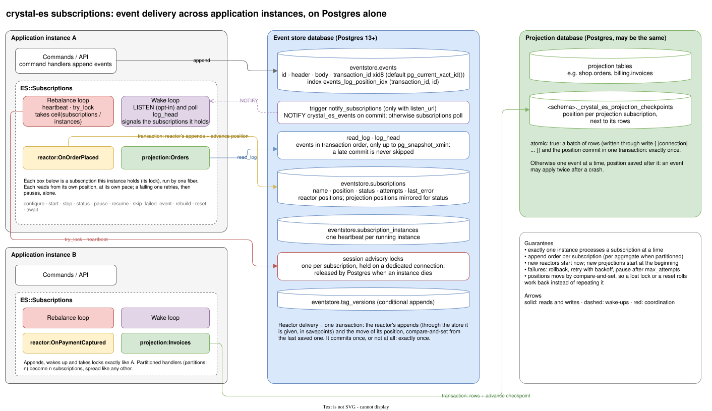

# Subscriptions

`ES::Subscriptions` delivers events from the event store to every reactor and projection wired in the `EventBus`, so that any number of application instances can run side by side. Each handler becomes a **subscription**. It follows the event store as a log from its own saved position, at its own pace. Exactly one instance processes a subscription at a time, and the instances share the subscriptions out evenly between them. No message broker is needed: everything lives in the event store's Postgres database.



The editable diagram is [`assets/subscriptions-architecture.drawio`](../assets/subscriptions-architecture.drawio).

```crystal
require "pg"

# The bus, event store, event handlers and projection database come from ES::Config
subscriptions = ES::Subscriptions.new(listen_url: ENV["DATABASE_URL"])
subscriptions.configure(OnOrderPlaced, partitions: 4) # optional, see below
subscriptions.start                                   # returns; processing runs in fibers
at_exit { subscriptions.stop }
```

Start it after `event_store.setup` and after the projections' `setup`, on every instance. `start` creates the tables it needs, gives new subscriptions their starting position and takes this instance's share. `stop` lets each subscription finish the event or batch at hand, then hands it over to the other instances.

## What is guaranteed

| | Reactors | Projections |
|---|---|---|
| Order | Append order per subscription (per aggregate when partitioned) | Same |
| Delivery | **Exactly once.** The reactor runs in an event store transaction together with the move of its position. Everything it appends through the store it was given commits with it, or not at all. | **Exactly once for `atomic: true` projections.** A batch of events and the projection's position commit in one transaction of the projection's database. Other projections apply one event at a time and save the position after it, so an event may be applied twice if the process dies in between. An event skipped because a key is missing (see below) also keeps the writes it made before that. |
| Where a new subscription starts | `:now`: a new reactor never acts on history. Pass `start: :beginning` to change that. | `:beginning` into an empty table. A table with rows but no position is refused. Use `start: :now` if it already holds every event so far. |
| Failure | Rolled back, retried with exponential backoff, paused after `max_attempts` (10). Only that subscription stops. | Same. A failed batch rolls back as a whole. |
| Position kept in | `eventstore.subscriptions` | `_crystal_es_projection_checkpoints` in the projection's schema, next to its rows |

## Reactors

Nothing changes in a reactor. It receives an event store bound to its transaction as `@event_store`. Pass it on, as reactors already do, and every command handler's append joins the transaction:

```crystal
class OnOrderPlaced < ES::Reactor
  def call(event : OrderPlaced)
    ReserveStockHandler.new(event_store: @event_store).handle(ReserveStock.new(event.header.aggregate_id))
  end
end
```

- **A handler that falls back to `ES::Config.event_store` writes outside the transaction.** Its append is not rolled back with the reactor. If it carries a tag the transaction has locked, it waits on that transaction forever on Postgres. The in-memory store raises instead.
- **Keep reactors short.** A reactor's transaction holds the tag rows it appended to, and while it is open no subscription can read past it (see [How it works](#how-it-works)). Send slow work (mail, HTTP calls, language models) to a job queue, with idempotent jobs.
- **A reactor that reads a projection** may run before that projection has caught up, since each subscription has its own pace. Hydrate the aggregate instead, or wait explicitly: `subscriptions.await(OrdersProjection, event, timeout: 5.seconds)` returns once the projection has processed the event, or false after the timeout.

## Projections

Declare a projection `atomic: true` and write its rows through `write`. While a subscription applies a batch, `write` yields the connection of the batch's transaction. Otherwise it opens a transaction of its own, so the projection still works with `EventBus#publish`:

```crystal
class OrdersProjection < ES::Projection
  include ES::ProjectionDSL

  define_projection "shop.orders", atomic: true do
    column :id, UUID, primary_key: true
    column :total, Int64
  end

  apply(OrderPlaced) do
    write do |connection|
      connection.exec %(INSERT INTO "shop"."orders" (id, total) VALUES ($1, $2)), aggregate_id, body.total
    end
  end
end
```

An `atomic: true` projection must write *only* through `write`: rows written on another connection don't roll back with a failed batch. `init: true` doesn't combine with subscriptions and is refused, because a subscription fills an empty projection from the beginning by itself. A projection can live in another database: `configure(OrdersProjection, database: reporting_db)`.

## Partitions

`configure(handler, partitions: n)` splits a subscription by aggregate id into `n` subscriptions, so up to `n` instances process that handler at once. Events of one aggregate stay in order. Partitions are fixed once a subscription has a position: changing them in place is refused.

## Operations

```crystal
subscriptions.status                       # => [Status(name, status, position, head, caught_up?, attempts, last_error, owned?)]
subscriptions.pause(OrdersProjection)      # on whichever instance holds it
subscriptions.resume(OrdersProjection)     # retries it, with its attempts reset
subscriptions.skip_failed_event(OnOrderPlaced)  # move past the event it keeps failing on (logged)
subscriptions.rebuild(OrdersProjection)    # truncate and replay; a non-atomic projection must be paused first
subscriptions.reset(OnOrderPlaced, to: :now) # or :beginning to run a reactor over history again
```

`status` reads the shared state, so any instance, or a one-off console, can report on all of them. A pause or reset made on one instance reaches the instance holding the subscription within `rebalance_interval` (5 seconds).

Options of `ES::Subscriptions.new`: `poll_interval` (1 second: how often to look for new events when not woken), `rebalance_interval` (5 seconds), `max_attempts` (10), `retry_base_delay` (1 second) and `retry_max_delay` (5 minutes).

`listen_url` makes an instance wake up the moment events are appended (Postgres LISTEN/NOTIFY, needs `require "pg"`). Without it, new events are picked up at the next poll. Listening has a cost for every writer of the store: it installs a trigger that sends a notification from each append transaction, and Postgres commits transactions that sent a notification one at a time. Use it where latency matters more than append throughput. Once no instance listens any more, drop the trigger with `DROP TRIGGER notify_subscriptions ON eventstore.events`.

## Specs and scripts

`catch_up` runs the subscriptions in the calling fiber instead of in the background, until they have processed everything appended so far, then returns. That includes the events the reactors append on the way, and the handlers those reach in turn. Use it in specs and one-off scripts, in place of `start` and `await`:

```crystal
subscriptions = ES::Subscriptions.new
subscriptions.catch_up                         # gives new subscriptions their position: reactors start at the head
event_store.append(OrderPlaced.new(...))
subscriptions.catch_up                         # OnOrderPlaced has run, and OrdersProjection holds the order
```

- **The guarantees are the same as under `start`.** Each event is processed in the same transaction as the move of the position, and what was processed is saved. Calling `catch_up` again goes on from there.
- **A failing handler's error is raised from `catch_up`**, not retried. The failed event or batch is rolled back, and the next `catch_up` tries it again. The error is raised in full, unlike under `start`, which logs and stores only its first line: a database error can carry row values, decrypted body data included, in its later lines. In a script against real data, rescue it and log only the class and first line.
- **Paused subscriptions are left alone.**
- **It refuses** a subscription another instance is processing, and can't be combined with `start` on the same `ES::Subscriptions`.
- **It raises after `timeout`** (30 seconds) if the subscriptions haven't caught up by then, for example because a reactor keeps appending events that reach it again.
- **`stop` releases its database session** once you're done.

With the in-memory event store, specs need no database: every `ES::Subscriptions` on the same store shares its state.

## How it works

- **Reading the store as a log.** `EventStore#read_log` returns events in the order of the transactions that appended them, and only up to `log_head`: the newest position before the oldest transaction still running (`pg_snapshot_xmin`). Event positions alone are taken at insert, not at commit, so a reader resuming after the last position it saw could skip an event that committed late. Reading up to the head never does. This is what `setup` adds the `transaction_id xid8` column and the `events_log_position_idx` index for.
- **One instance per subscription.** Each instance takes Postgres session advisory locks, one per subscription, on one connection it keeps for that. If an instance dies, its connection goes and its locks with it, and another instance takes over within `rebalance_interval`. Instances record heartbeats in `eventstore.subscription_instances` and each takes `ceil(subscriptions / instances)`, so work spreads as instances come and go.
- **Positions move by compare-and-set.** A position is only moved from the value the instance last saved. An instance that lost its lock, or a subscription reset meanwhile, finds it moved and rolls its work back instead of applying an event twice.
- **Waking up.** Every instance polls `log_head` every `poll_interval`. With `listen_url`, a statement trigger on the events table also sends `NOTIFY crystal_es_events`, and listening instances wake at once.

## Requirements and limits

- **Postgres 13 or later** for `read_log` (xid8). On older servers the event store works as before, without subscriptions.
- **Session-mode connections.** The locks are session locks: don't run subscriptions through a pooler in transaction mode (PgBouncer `pool_mode = transaction`).
- **Long transactions delay delivery.** The oldest writing transaction anywhere in the Postgres cluster holds the head back until it ends: a session idle in a transaction, a forgotten prepared transaction, a long migration in another database. Nothing is lost, but nothing is delivered past it either. Set `idle_in_transaction_session_timeout`, and monitor the age of the oldest transaction (`age(backend_xid)` in `pg_stat_activity`, and `pg_prepared_xacts`).
- **Positions are transaction ids of the cluster.** Moving the store to another cluster with `pg_dump` or logical replication can bring transaction ids the new cluster hasn't reached yet. Reading the log then raises until the new cluster's transaction counter is past the highest stored `transaction_id`. `pg_upgrade` and physical replicas keep the counter and are not affected.
- **An event whose key is missing is skipped.** As in `read` and replays, an event whose encryption key can't be found counts as erased: subscriptions log a warning and move past it. The key store raises the same error for a destroyed key and for one that never existed, so an instance started against the wrong or an empty key store skips every encrypted event. Check the key store configuration before starting subscriptions.
- **`last_error` stores the exception class and the first line of the message** of a failing handler in `eventstore.subscriptions`, which `pg_monitor` can read. Later lines, where Postgres puts row values, are dropped. Don't put personal data in the first line of your own exceptions.
- The in-memory event store implements all of this in the process, for specs. Every `ES::Subscriptions` on the same in-memory store shares its state, like instances sharing a database.

## Moving from the queue

The [queue](configuration.md#queue) and a consumer calling `EventBus#publish` keep working, but the queue is deprecated as the way to deliver events and will be removed in a later release. Subscriptions replace it:

1. **Projections one at a time, no downtime.** Unsubscribe the projection from the queue consumer's bus and empty its table: the subscription fills it from the beginning. Or keep its rows and `configure(..., start: :now)` when no event can be in flight. Remove `init: true`.
2. **Reactors together, in a short write pause.** Stop accepting commands for a moment, let the queue drain, start the subscriptions (reactors start `:now`), then accept commands again. Without a pause, an event appended during the switch could reach a reactor twice, or not at all.
3. Remove the queue's trigger from `eventstore.events` once nothing consumes it.
